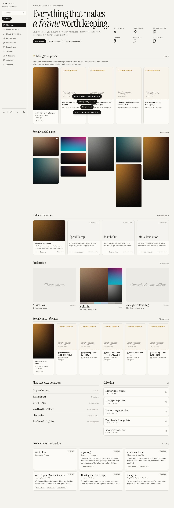
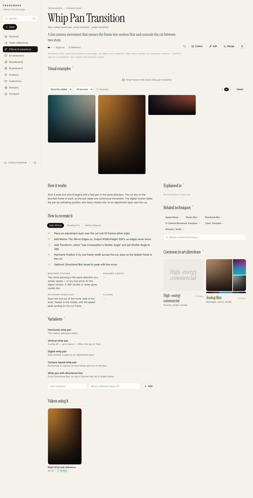
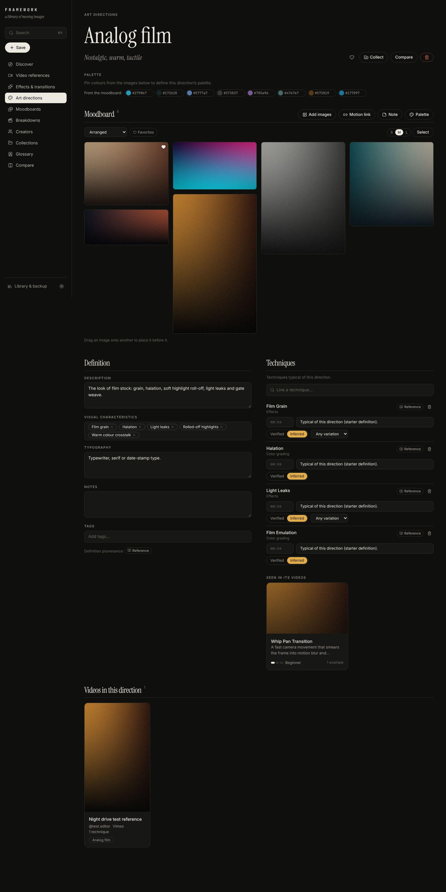
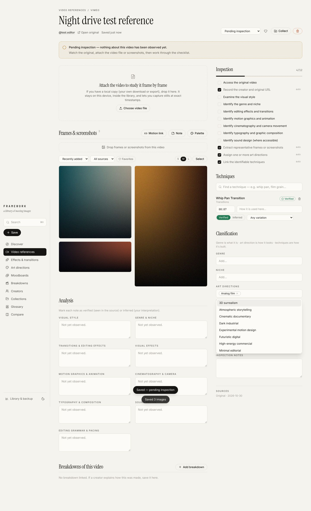
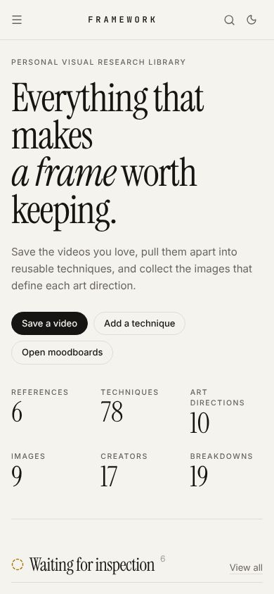

# FRAMEWORK

**A personal library of video editing techniques, transitions, effects, art directions and creator breakdowns.**

FRAMEWORK is a local-first working library, not a streaming site and not a Pinterest clone. You save videos you find visually interesting, break them down into reusable techniques, collect images into art-direction moodboards, and trace each technique back to the creators who explain how it is made.



## Quick start

```bash
npm install
npm run dev          # http://localhost:5173
```

Production build (static files that run from any folder or static host):

```bash
npm run build
npm run preview      # or serve dist/ with any static server
```

No account, no server, no cloud. Everything is stored in your browser's IndexedDB on this device. **Back up from *Library & backup*.** A backup is a ZIP holding `library.json` plus every original image and video.

## What's inside

| Layer | Page | What you can do |
|---|---|---|
| 1 · Video references | **Video references** | Save a URL (duplicate URLs are detected), filter by platform, creator, genre, niche, art direction, software, technique, status or date. Each reference has a 12-step inspection checklist, analysis notes marked *verified* or *inferred*, a frame gallery, and an optional **local video file**. Attach one, scrub it and **capture frames** at exact timestamps. |
| 2 · Techniques | **Effects & transitions** | 78 reusable entries across 10 categories (transitions, effects, motion graphics, animation, camera movement, cinematography, typography, sound design, editing grammar, color grading). Each has a visual description, how it works, step-by-step workflows per tool, variations, keyframe principles, required footage and plugins, related techniques, examples, the videos using it, the breakdowns and creators explaining it, and the art directions where it's common. |
| 3 · Art directions | **Art directions**, **Moodboards**, **Compare** | Every direction owns a masonry moodboard that preserves aspect ratios. Drag-and-drop or paste (⌘V) uploads, drag to rearrange, filter by tag, type or source, sort by date, a full-screen lightbox with metadata editing, side-by-side comparison of 2–4 images, and palettes suggested from the images' extracted colours. Personal boards hold images before they belong to a direction and can be promoted later. |
| 4 · Creators & breakdowns | **Creators**, **Breakdowns** | A creator directory with evaluation status, depth rating, software and specialisations. A breakdown archive with a timestamped timeline (each step links to techniques and seeks the player), chapter-list import, and a searchable transcript you paste yourself (VTT, SRT or timestamped lines). |
| — | **Collections** | Mix anything into named sets ("Effects I want to recreate", "References for game trailers"…). |
| — | **Glossary** | Technical terms linked to techniques; doubles as an A–Z technique index. |
| — | **Search** (⌘K or /) | One search across videos, techniques, creators, breakdowns, art directions, moodboards, images, collections and glossary. Related names are folded in, so "DaVinci Resolve" finds creators, workflows and breakdowns. |

### Not creating duplicates
- Typing a technique name always shows existing techniques, aliases included, before offering to create a new one ("swish pan" → *Whip Pan Transition*).
- Creating an exact duplicate name or alias is refused at the data layer.
- **Merge** folds a duplicate into the original, moving all its examples, variations, relations and collection memberships.

### Genre, art direction and technique stay separate
A video has a *genre* (what it is), *art directions* (how it looks) and linked *techniques* (how it's built). Each is chosen independently, and each link to a technique carries its own timestamp, variation, note and provenance.

## Honesty rules built into the data

- **Provenance on everything:** *Verified* (seen in the source), *Inferred* (interpretation or suggestion), *Reference* (general knowledge), *Yours*.
- **No invented timestamps or transcripts.** Timestamps are empty (`null`) until you enter one you checked. Transcripts only come from pasted captions.
- **Pending inspection** is a real state. A reference stays pending until you record what you actually saw.
- **Attribution** (source URL, creator, date accessed) is kept on references, creators, breakdowns and every image.

## Seed data and research conditions

The library starts with the brief's material plus Phase 1 research. See [docs/RESEARCH.md](docs/RESEARCH.md) for the full log.

- **5 Instagram references** (@jordans.archivess ×2, @austinwhite711, @yuyenwng ×2) are stored as **pending inspection**. The research environment blocked instagram.com, so none was watched and no analysis is claimed. The yuyenwng references are flagged to capture interface, timeline and effects-panel screenshots.
- **16 creators**: the 3 reference creators plus 13 educators from the brief. All are *candidates* described from web-search sources, which are listed on each creator.
- **19 breakdown videos** with real URLs and their indexed titles. youtube.com was blocked too, so they are unwatched, and their technique links are *inferred* from titles only.
- **78 techniques** (92 variations) as *reference* entries, **10 starter art directions** from the brief (empty moodboards, no invented palettes), **34 glossary terms**, and the brief's example **collections** and **moodboards**, created empty.

No images are seeded. The library's visual content is yours.

## Testing

```bash
npm test             # unit tests: seed integrity, duplicate prevention, merge, cascades, search, backup round-trip, transcript parsing
npm run build && npm run test:e2e
                     # Playwright against the production build: save → link technique → upload → reload → search → collect → backup → erase → restore, plus mobile overflow checks and console errors
SCREENSHOTS=1 npm run test:e2e   # also refreshes docs/screenshots/
```

The e2e run uses generated gradient PNGs as upload fixtures. They are test data, not seed data.

## Docs

- [Architecture & trade-offs](docs/ARCHITECTURE.md): why IndexedDB, the data model, search, the backup format
- [Taxonomy](docs/TAXONOMY.md): genres, art directions, categories, naming conventions
- [Research log](docs/RESEARCH.md): what was found, and what could not be verified

## Screenshots

| Technique | Art direction (dark) |
|---|---|
|  |  |

| Video reference | Mobile |
|---|---|
|  |  |
