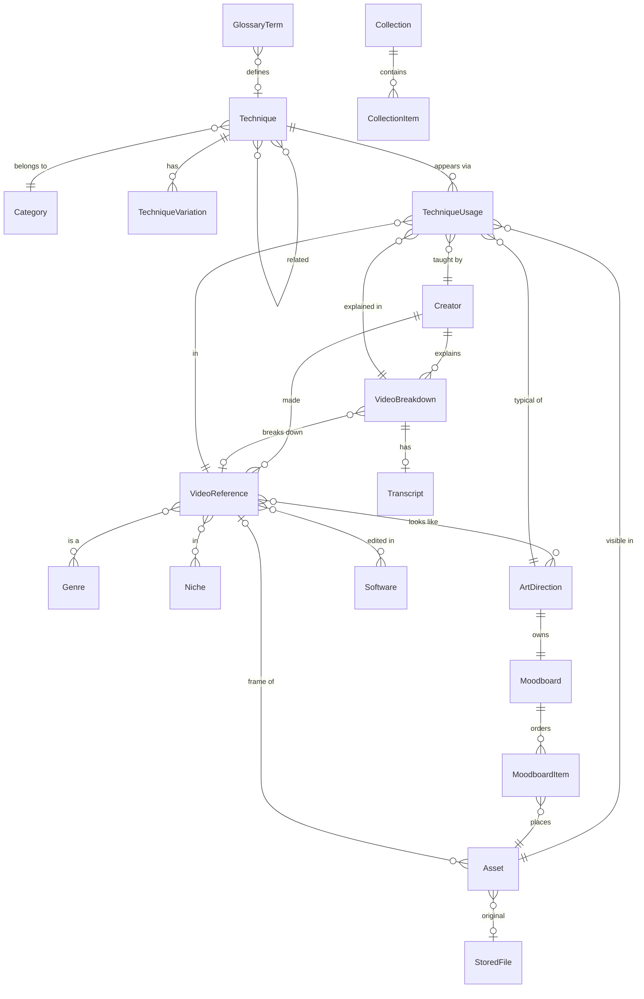

# Architecture

## Decision: browser-only, IndexedDB, ZIP backups

FRAMEWORK is a static React app with no server. All data, including uploaded images and videos, lives in the browser's IndexedDB (through [Dexie](https://dexie.org)). Backups are plain ZIP files.

| Option considered | Pros | Cons | Verdict |
|---|---|---|---|
| **IndexedDB in the browser (chosen)** | Nothing to install or run; works offline; stores binary blobs natively; reactive queries via `dexie-react-hooks`; the build is a folder of static files | Data lives in one browser profile, so moving it means a backup; browsers may evict best-effort storage (mitigated by `navigator.storage.persist()` and backups) | ✅ |
| Local Node server + SQLite + images on disk | The library is a folder you can copy; SQL queries | You have to run a server every session; more moving parts; a second process to keep alive | ✗ — too much friction for a personal tool |
| SQLite compiled to WASM (OPFS) | SQL in the browser | Needs special headers (COOP/COEP) for OPFS sync access; binaries in OPFS are harder to inspect; little gain over IndexedDB at personal scale | ✗ |
| Electron / Tauri desktop app | Real files on disk | Heavy packaging; slow to iterate | ✗ for v1. The data layer would port as-is if needed later |

**Migration path:** export a backup on machine A, open the app on machine B, then go to *Library & backup → Restore → Replace*. The ZIP holds `library.json` plus the original files, so it is readable without the app.

## Stack

- React 18 + TypeScript + Vite 6
- Tailwind CSS 3, with design tokens as CSS variables (light and dark)
- Dexie 4 (IndexedDB) and `dexie-react-hooks` for live queries
- MiniSearch for library-wide fuzzy search
- fflate for ZIP backup and restore
- Fonts bundled with `@fontsource` (Instrument Serif, Inter, JetBrains Mono), so no network is needed
- `HashRouter`, so `dist/` works from any static host or a plain folder

## Data model



Key decisions:

- **Genre, art direction and technique are separate dimensions.** A video has `genreIds` (what it is) and `artDirectionIds` (how it looks), and links to techniques (how it is built) through usage rows.
- **Techniques are never owned by a video.** `TechniqueUsage` is the join row, and it carries its own data: an optional timestamp (`null` unless verified), a variation, a note and a provenance. Five whip pans in five videos means one `Technique` and five usages.
- **Duplicate prevention lives in the data layer.** `createTechnique` refuses a name or alias that already exists. `findSimilarTechniques` (trigram plus alias matching) drives the "already in your library" prompts. `mergeTechniques` folds a duplicate into the original and moves every usage, variation, relation, glossary link and collection item.
- **Each art direction owns one moodboard.** Images reach a direction through `MoodboardItem` rows, which also store the manual order, so drag-to-reorder and moving images between boards are single-row edits. Personal boards have `artDirectionId = null` and can be promoted later. Deleting a direction keeps its images; the board just becomes personal.
- **Binary data is kept apart from metadata.** Originals and thumbnails sit in a `files` table, so listing and searching never load blobs. The thumbnail (WebP, 900 px) is generated on upload, and the original is never modified.
- **Provenance is on every record** (`verified` / `inferred` / `reference` / `user`) and on every analysis note and technique usage. The UI shows it as a badge.
- **Attribution:** every asset keeps `sourceUrl` and `attribution`. Videos, creators and breakdowns keep `sources[]` with the date each source was accessed.

Indexes worth knowing:
- `usages`: `[targetType+targetId]` (what is used in X) and `techniqueId` (where is Y used)
- multi-entry indexes: `videos.*artDirectionIds`, `*genreIds`, `*tagIds`, `techniques.*relatedIds`, …

## Search

`src/db/search.ts` builds one MiniSearch index over every entity. Names of connected things are folded into each document (software, tags, categories, creators, art directions, linked techniques). That is how "DaVinci Resolve" reaches creators, techniques with a Resolve workflow and breakdowns, and how "dark" reaches art directions and their techniques. The index rebuilds through a live query whenever the library changes, which is fast at personal scale (thousands of records).

## Backup format

```
framework-backup-YYYY-MM-DD.zip
├── manifest.json     { app: "framework-library", schemaVersion, exportedAt, counts, files[] }
├── library.json      { tags: [...], techniques: [...], videos: [...], ... }
├── README.txt
└── files/<fileId>.<ext>
```

Restoring has two modes: **replace**, which wipes the library and loads the backup, and **merge**, which upserts by id. Restore checks the app id and schema version, and marks the library as seeded so starter data is never re-applied on top.

## Code map

```
src/
  db/          types, Dexie schema, repo (CRUD + cascades), images, backup, search, seed/
  lib/         utilities (URL canonicalisation, time parsing), hooks, transcript parser
  components/  layout, search palette, gallery/moodboard, lightbox, uploader, pickers, cards, usage editor
  pages/       one file per route
tests/         Vitest unit tests (fake-indexeddb)
scripts/e2e.mjs  Playwright end-to-end run against the production build
```
